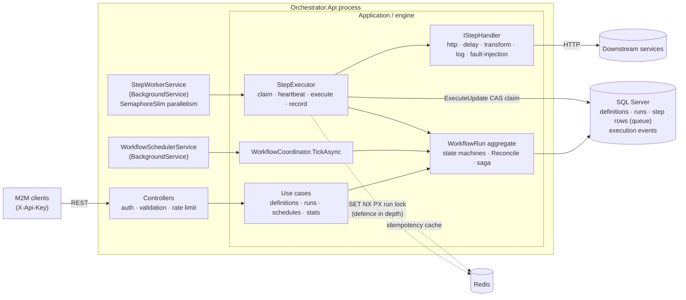
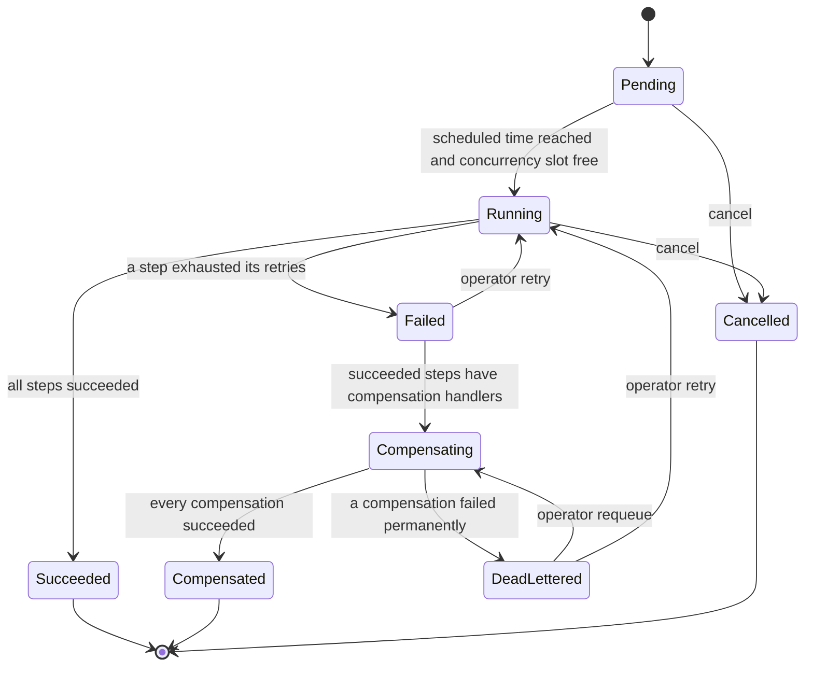
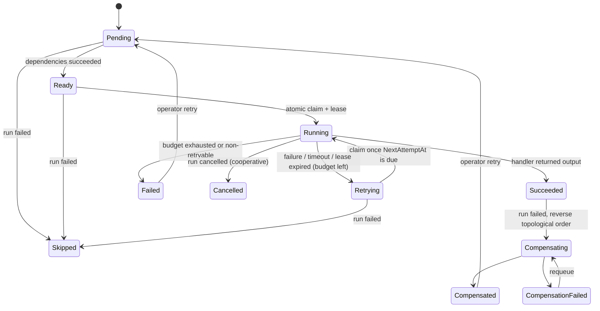
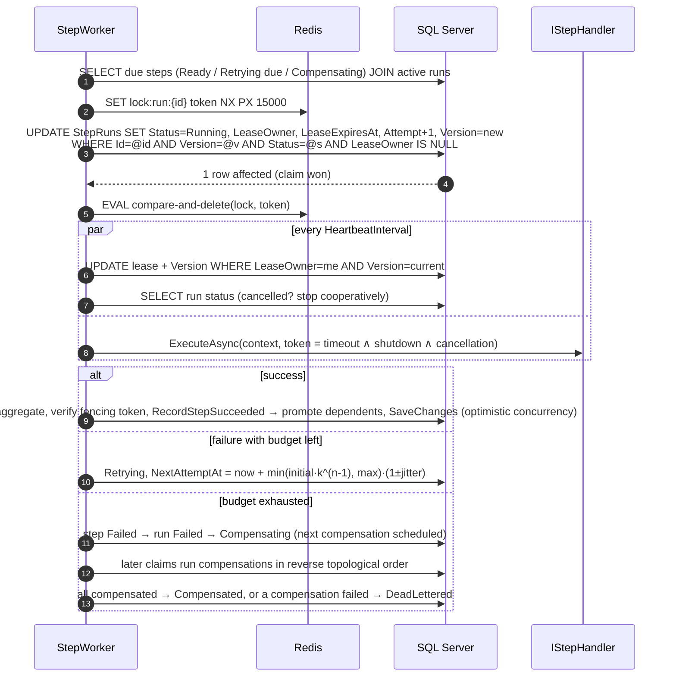
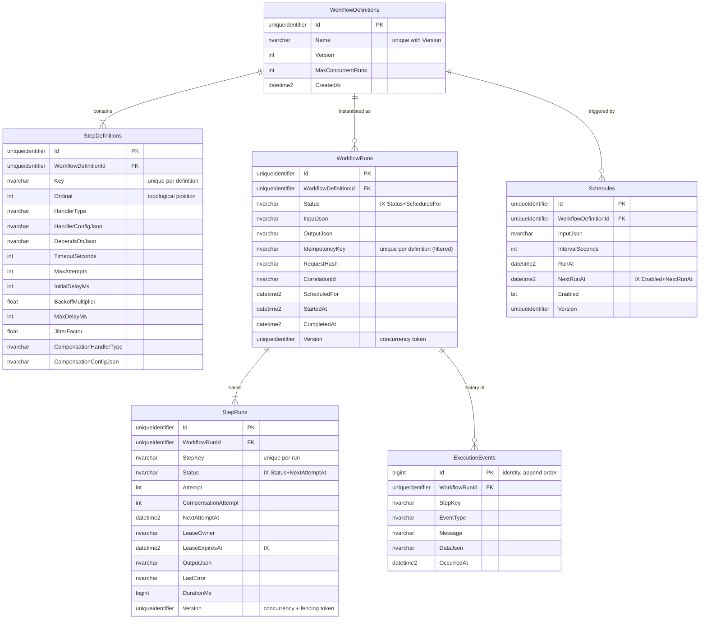

# Workflow Orchestrator

Asynchronous DAG workflow / task orchestration backend in ASP.NET Core 8 — durable runs, leased step execution, exponential-backoff retries, saga compensation, schedules and dead letters, with SQL Server as the work queue and Redis for coordination.

[](https://github.com/unmeshpawar7-cpu/workflow-orchestrator/actions/workflows/ci.yml)
[](LICENSE)


[At a glance](#at-a-glance) · [Phases](#project-phases) · [Problem](#problem) · [Architecture](#architecture) · [Features](#key-features) · [API](#api-endpoints) · [Security](#security) · [Testing](#testing) · [Run locally](#running-locally) · [Docker](#docker)

## At a glance

| Area | Summary |
|---|---|
| **What it does** | Runs multi-step workflows (DAGs) reliably: survives crashes, retries with backoff, undoes completed steps when a later one fails (saga), runs schedules and parks unrecoverable runs as dead letters |
| **Stack** | .NET 8 · ASP.NET Core · EF Core 8 · SQL Server 2022 (work queue) · Redis (coordination) · Serilog · xUnit |
| **Reliability** | Leased step claims with fencing tokens · exponential backoff with jitter · idempotent run creation · append-only execution history |
| **Quality** | 313 tests passing in CI (297 unit + 16 integration) · 75.4% line / 78.3% branch coverage |
| **Security** | API keys stored as SHA-256 digests · role hierarchy admin ⊇ operator ⊇ reader · rate limiting · SSRF guard |
| **Run it** | `cp .env.example .env && docker compose up --build` → Swagger at `http://localhost:8080/swagger` |

## Project phases

How the project was built, from the problem to a deployable service. Each phase links to the details below.

| # | Phase | What was delivered | Details |
|---|---|---|---|
| 1 | **Problem & requirements** | Hand-rolled chains of service calls lose work when a process crashes, retry inconsistently, cannot undo partial work and leave no audit trail | [Problem](#problem) |
| 2 | **Design** | Clean Architecture; the database is the queue (no broker); compare-and-swap claims instead of locks; 4 ADRs | [Architecture](#architecture) · [ADRs](docs/adr) |
| 3 | **Workflow model** | Immutable, versioned DAG definitions validated up front, including cycle detection that reports the cycle path; step outputs as inputs through templates | [Key Features](#key-features) |
| 4 | **Execution engine** | Coordinator and workers with leased claims, heartbeats, per-attempt timeouts, cancellation, retries and lease recovery | [Execution semantics](docs/execution-semantics.md) |
| 5 | **Failure handling** | Saga compensation in reverse topological order, dead letters with requeue, forward retry of failed runs | [Architecture](#architecture) |
| 6 | **API & operations** | REST API, schedules, idempotency keys, statistics, health checks, correlation ids | [API Endpoints](#api-endpoints) |
| 7 | **Security** | Hashed API keys with fixed-time comparison, role policies, rate limits, SSRF guard, input limits | [Security](#security) |
| 8 | **Testing** | 313 tests, including engine tests on SQLite and full-host integration tests; 75.4% line coverage measured in CI | [Testing](#testing) |
| 9 | **Delivery** | Multi-stage non-root Docker image, docker compose with SQL Server and Redis, GitHub Actions (build, test, coverage summary, Docker build) | [Docker](#docker) |

## Problem

Business processes such as "reserve stock → charge card → ship → notify" span several services, each of which can be
slow, flaky or down. Hand-rolled chains of HTTP calls lose work when a process crashes, retry inconsistently, cannot
undo partial work, and give operators no audit trail. Teams need a small, dependable engine that runs multi-step
workflows **asynchronously**, survives crashes, retries safely and compensates when something cannot be completed.

## Solution

Workflows are registered as immutable, versioned **DAGs of steps**. Starting a workflow creates a **run** whose steps
are persisted as rows; a coordinator promotes steps whose dependencies have succeeded, and workers **claim** ready
steps with an atomic conditional `UPDATE` plus a time-limited **lease**, execute the configured handler with a timeout,
and record the outcome. Failures are retried with exponential backoff and jitter; when a step exhausts its retries the
run fails and **compensation handlers** of already-completed steps run in reverse topological order (saga pattern). If
a compensation also fails the run is **dead-lettered** for an operator to requeue or retry. Every transition is written
to an append-only **execution history**.

## Architecture



Clean Architecture: `Domain` (aggregates, state machines, DAG validation, retry policy — no dependencies) ←
`Application` (use cases, engine core, ports) ← `Infrastructure` (EF Core, Redis, handlers, hosted loops) ← `Api`.
The scheduler and worker are separate `BackgroundService`s that only depend on application interfaces; they run inside
the API process today and can be moved to a dedicated worker host unchanged (see
[docs/architecture.md](docs/architecture.md#splitting-the-worker-into-its-own-host)).

### Run lifecycle



### Step lifecycle



### Claim → execute → retry → compensate



## Key Features

- **DAG definitions, validated up front** — duplicate keys, unknown/self dependencies, cycles (Kahn's algorithm, the
  offending cycle is reported as a path such as `b -> c -> a -> b`), step limit, registered handler types, and template
  references that must point at upstream steps. Definitions are immutable; posting the same name creates the next version.
- **Durable, leased execution** — atomic compare-and-swap claim with `ExecuteUpdateAsync` (works on SQL Server and
  SQLite), leases extended by heartbeats, the row `Version` used as a **fencing token** so a worker that lost its lease
  can never record a result, and expired leases recovered into `Retrying`.
- **Retries** — per-step max attempts, initial delay, multiplier, cap and jitter; pure `RetryPolicy` driven by
  `TimeProvider`. Handlers can mark failures non-retryable (e.g. HTTP 4xx).
- **Timeouts & cancellation** — per-attempt timeout, host shutdown and run cancellation combined in a linked
  `CancellationTokenSource`; `POST /api/runs/{id}/cancel` stops in-flight steps cooperatively.
- **Saga compensation** — compensation handlers of succeeded steps run one at a time in reverse topological order;
  late successes of in-flight sibling branches are compensated too. Failed compensations dead-letter the run.
- **Operator recovery** — retry (forward recovery: re-run failed steps and everything downstream) and dead-letter
  requeue (backward recovery: retry failed compensations).
- **Step outputs as inputs** — `{{input.x}}` and `{{steps.<key>.output.<path>}}` placeholders in handler configuration;
  a path lookup only, no expression evaluation.
- **Idempotent run creation** — `Idempotency-Key` header; Redis cache first, unique index on
  `(DefinitionId, IdempotencyKey)` as the source of truth; same key + same canonical payload → existing run (200),
  different payload → 409.
- **Schedules** — interval and/or one-off; missed slots are coalesced; deterministic idempotency keys make concurrent
  scheduler instances safe.
- **Execution history** — append-only `ExecutionEvents` written in the same transaction as the state change.
- **Operations** — API-key auth with roles, per-key rate limiting on run creation, `/health/live` + `/health/ready`
  (database + Redis), correlation ids in logs and error envelopes, aggregate-query statistics.

## Technology Stack

| Area | Choice |
| --- | --- |
| Runtime / API | .NET 8, ASP.NET Core controllers, Swashbuckle (OpenAPI + XML docs) |
| Persistence | EF Core 8, SQL Server 2022 (SQLite in tests) |
| Coordination | StackExchange.Redis (distributed lock, idempotency cache), in-memory fallbacks |
| Validation / logging | FluentValidation, Serilog (compact JSON console), built-in rate limiter, health checks |
| Testing | xUnit, FluentAssertions, NSubstitute, `WebApplicationFactory`, SQLite |
| Delivery | Multi-stage Docker image (non-root), docker-compose, GitHub Actions |

## Project Structure

```
├── Orchestrator.sln
├── src
│   ├── Orchestrator.Domain          aggregates (WorkflowDefinition, WorkflowRun/StepRun, Schedule), state machines,
│   │                                WorkflowGraph (DAG validation), RetryPolicy, TemplateSyntax, ExecutionEvent
│   ├── Orchestrator.Application     use cases, contracts + validators, engine core (StepExecutor, WorkflowCoordinator,
│   │                                RunMutator, TemplateResolver), ports (IOrchestratorDbContext, locks, idempotency)
│   ├── Orchestrator.Infrastructure  EF Core DbContext/configurations/migration, Redis + in-memory coordination,
│   │                                built-in step handlers, hosted scheduler/worker services
│   └── Orchestrator.Api             controllers, API-key auth, error envelope, rate limiting, health, Program.cs
├── tests
│   ├── Orchestrator.UnitTests       domain, application, handlers, locks, engine (SQLite) tests
│   └── Orchestrator.IntegrationTests WebApplicationFactory tests against the real host
├── samples                          workflow definitions, run requests, a schedule
├── docs                             architecture, execution semantics, API examples, ADRs
├── docker/Dockerfile
└── docker-compose.yml
```

## API Endpoints

All routes require `X-Api-Key` except health checks. Roles are hierarchical: `workflow.admin` ⊇ `workflow.operator` ⊇ `workflow.reader`.

| Method | Route | Auth (minimum role) | Description |
| --- | --- | --- | --- |
| POST | `/api/workflows` | admin | Register a definition (201 + Location; 400 with field errors incl. cycle path) |
| GET | `/api/workflows` | reader | List definitions (`?name=&page=&pageSize=`) |
| GET | `/api/workflows/{id}` | reader | Definition with steps in topological order |
| POST | `/api/workflows/{id}/runs` | operator (rate limited) | Start a run; `Idempotency-Key` supported (202 + Location / 200 replay / 409) |
| POST | `/api/workflows/{id}/schedules` | operator | Create an interval and/or one-off schedule (201) |
| GET | `/api/runs` | reader | List runs (`?status=&definitionId=&page=&pageSize=`) |
| GET | `/api/runs/{id}` | reader | Run with every step's status, attempts, lease, output, error, duration |
| GET | `/api/runs/{id}/history` | reader | Append-only execution events (paginated) |
| POST | `/api/runs/{id}/cancel` | operator | Cancel a Pending/Running run (202; 409 otherwise) |
| POST | `/api/runs/{id}/retry` | operator | Re-run a Failed/DeadLettered run from its failed steps (202; 409 otherwise) |
| GET | `/api/dead-letters` | reader | Dead-lettered runs (paginated) |
| POST | `/api/dead-letters/{runId}/requeue` | operator | Retry the failed compensations (202; 409 if not dead-lettered) |
| GET | `/api/schedules` | reader | List schedules |
| GET | `/api/schedules/{id}` | reader | Get a schedule |
| PATCH | `/api/schedules/{id}` | operator | Enable / disable |
| GET | `/api/stats` | reader | Run and step counts by status, average step duration, retry counts |
| GET | `/health/live`, `/health/ready` | anonymous | Liveness; readiness (database, Redis when enabled) |

Lists return `{ items, page, pageSize, totalCount, totalPages }` (`pageSize` capped at 100). More examples in
[docs/api-examples.md](docs/api-examples.md).

## Database Design



JSON documents are stored as `nvarchar(max)` strings and enums as strings, so the same model works on SQL Server and
SQLite. Concurrency tokens are `Guid` `Version` columns regenerated in code (not `rowversion`) for the same reason. The
`InitialCreate` migration and model snapshot under `src/Orchestrator.Infrastructure/Persistence/Migrations` were
**written by hand** to match the model (no SDK was available); `dotnet ef migrations add` can regenerate them if they drift.

## Security

- **API keys for machine-to-machine access** ([ADR 0004](docs/adr/0004-api-keys-for-m2m.md)). Keys are configured as
  SHA-256 digests (`ApiKeys:Keys[n]:KeyHash`), never in plaintext; the presented key is hashed and compared with
  `CryptographicOperations.FixedTimeEquals` against every entry. The entry's name and roles become claims.
- **Authorization policies** per endpoint: definitions are admin-only (they decide which URLs the engine calls),
  run/schedule commands need operator, reads need reader.
- **Rate limiting**: fixed window per API key on run creation (`RateLimiting:RunCreation`), 429 with `Retry-After`.
- **SSRF guard**: the `http` handler only allows absolute http(s) URLs and, when `Handlers:Http:AllowedHosts` is set,
  only those hosts. Configure it in any shared deployment.
- **No scripting**: templates are path lookups over JSON; nothing in a definition is evaluated as code.
- **Input limits**: run input ≤ 256 KB, ≤ 50 steps per definition, bounded timeouts/attempts, response bodies truncated.
- **Secrets** come from environment / `.env` (git-ignored); the repository only contains digests of documented local demo keys.
- Errors use a consistent envelope with a `traceId` (the correlation id) and never leak stack traces.

## Testing

```bash
dotnet test Orchestrator.sln --collect:"XPlat Code Coverage"
```

No external services are needed: tests use SQLite and the in-memory lock / idempotency implementations.

- **Unit (`Orchestrator.UnitTests`)** — DAG validation (cycle path, unknown/self/duplicate keys, template reference
  rules, topological order), the complete run and step transition matrices (every pair, valid and invalid), the run
  aggregate (dependency promotion, fan-in, compensation order, dead-letter, requeue, retry from failed steps, cancel,
  lease recovery), retry maths with a manual `TimeProvider` (backoff, cap, jitter bounds), schedule semantics,
  template resolver, canonical-JSON idempotency hashing, request validation, every built-in handler (HTTP with a stubbed
  `HttpMessageHandler`), the in-memory lock provider, and the samples.
- **Engine tests** run the real coordinator and executor over SQLite by calling `TickAsync` / `ProcessNextAsync`
  directly: A→B→C with B failing twice then succeeding; B always failing → A compensated → `Compensated`; a hanging step
  hitting its timeout and succeeding on retry; lease expiry recovery with the stale worker fenced out; exclusive claims
  under concurrency; cooperative cancellation; `MaxConcurrentRuns`; schedules; idempotency including a cache outage.
- **Integration (`Orchestrator.IntegrationTests`)** — `WebApplicationFactory<Program>` with the hosted scheduler and
  worker running: 401/403, health, correlation id, OpenAPI generation, versioning, cycle → 400, idempotent replay and
  409, end-to-end run, dead-letter + requeue against a controllable downstream stub, cancel, retry, pagination, schedules.

**Measured in CI** ([run #7](https://github.com/unmeshpawar7-cpu/workflow-orchestrator/actions/runs/45168564132),
23 Nov 2026, .NET 8 on `ubuntu-latest`): **297 unit tests (including theory rows) and 16 integration tests passed,
0 failed**, and the Docker image job succeeded.

Merged unit + integration coverage is **75.4% of lines (2,645 / 3,506) and 78.3% of branches (780 / 995)**:

| Assembly | Line coverage |
|---|---|
| Orchestrator.Api | 93.5% |
| Orchestrator.Domain | 92.3% |
| Orchestrator.Application | 91.6% |
| Orchestrator.Infrastructure | 37.8% |

Infrastructure is low mainly because the hand-written EF Core migration is never executed (the tests create the schema
with `EnsureCreated`) and the Redis coordination code is mostly not exercised (the tests use the in-memory lock
and idempotency implementations).

## Running Locally

Prerequisites: .NET 8 SDK and Docker (for SQL Server + Redis).

```bash
docker compose up -d sqlserver redis           # needs .env (cp .env.example .env)
dotnet run --project src/Orchestrator.Api      # Development: migrations applied, Swagger at http://localhost:5080/swagger
```

`appsettings.Development.json` points at `localhost:1433` with the password from `.env.example` and contains the
digests of three demo keys: `dev-admin-key-change-me`, `dev-operator-key-change-me`, `dev-reader-key-change-me`.
Set `Redis:Enabled=true` to use Redis locally (it is off by default, which uses in-memory coordination — single instance only).

## Docker

```bash
cp .env.example .env        # set MSSQL_SA_PASSWORD; replace the key digests outside local demos
docker compose up --build   # api :8080 (Swagger at /swagger), SQL Server :1433, Redis :6379
```

The API container waits for healthy SQL Server and Redis, applies migrations on startup
(`Database__ApplyMigrationsOnStartup=true`), runs as the non-root `app` user and exposes `/health/live` for its health check.

## Example API Request

```bash
# 1) register the saga (admin)
curl -s -X POST http://localhost:8080/api/workflows \
  -H "X-Api-Key: dev-admin-key-change-me" -H "Content-Type: application/json" \
  -d @samples/workflows/order-fulfilment-saga.json

# 2) start a run whose payment step fails -> compensation (operator)
curl -s -X POST http://localhost:8080/api/workflows/<definitionId>/runs \
  -H "X-Api-Key: dev-operator-key-change-me" -H "Content-Type: application/json" \
  -H "Idempotency-Key: ord-1002" \
  -d @samples/runs/order-fulfilment-payment-declined.json
```

## Example API Response

`GET /api/runs/{id}` once the run above has settled (abridged):

```json
{
  "success": true,
  "data": {
    "id": "6f0c3c2e-4b8e-4f43-9d0a-2f1b8a7d9e10",
    "workflowDefinitionId": "0b7f2a4e-1c3d-4e5f-8a9b-1c2d3e4f5a6b",
    "status": "Compensated",
    "correlationId": "3c9d7e1f0a2b4c6d8e0f1a2b3c4d5e6f",
    "idempotencyKey": "ord-1002",
    "error": "Step 'charge-payment' failed after 1 attempt(s): StepFailedException: Payment declined by issuer (simulated)",
    "steps": [
      { "key": "validate-order", "status": "Succeeded", "attempt": 1, "durationMs": 3 },
      { "key": "reserve-inventory", "status": "Compensated", "attempt": 1, "compensationAttempt": 1 },
      { "key": "charge-payment", "status": "Failed", "attempt": 1,
        "lastError": "StepFailedException: Payment declined by issuer (simulated)" },
      { "key": "create-shipment", "status": "Skipped", "attempt": 0 },
      { "key": "notify-customer", "status": "Skipped", "attempt": 0 }
    ]
  },
  "message": null
}
```

`charge-payment` is non-retryable in the sample, so it fails on the first attempt; `reserve-inventory` is compensated;
`validate-order` has no compensation handler and stays `Succeeded`. (Values above are illustrative, not captured output.)

## Future Enhancements

- Dedicated `Orchestrator.Worker` host project (the hosted services are already host-agnostic).
- Push-style wake-ups (SQL Server change notifications / Redis pub-sub) to reduce polling latency.
- Partitioned claiming (`UPDLOCK, READPAST` batch claims) for very high step throughput.
- Conditional branches, fan-out over arrays (map steps) and sub-workflows.
- Compensate-on-cancel as an opt-in policy; per-step concurrency limits.
- OpenTelemetry traces spanning the API request, the run and each attempt; Prometheus metrics.
- Retention / archival of execution history.

## Engineering Highlights

- **The database is the queue** ([ADR 0001](docs/adr/0001-db-as-queue-with-leases.md)). Run state and the work queue
  live in the same rows, so "the step succeeded" and "its dependents are ready" commit in one transaction — no dual
  writes between a database and a broker. The cost is polling and a throughput ceiling far below a broker; for
  orchestration (low-volume, high-value, long-running work) that trade is usually right.
- **Correctness from compare-and-swap, not from locks** ([ADR 0002](docs/adr/0002-redis-lock-defence-in-depth.md)). A
  claim is a single conditional `UPDATE` on `(Id, Version, Status, LeaseOwner IS NULL)`; the `Version` doubles as a
  fencing token that heartbeats rotate, so a paused or partitioned worker cannot overwrite a newer attempt. The Redis
  run lock only reduces contention; a Redis outage degrades it to a no-op.
- **Level-triggered reconciliation.** `WorkflowRun.Reconcile` derives the next state from current step states and is
  idempotent. Workers call it right after recording a result (fast path); the scheduler calls it for idle runs (safety
  net). A crash between "step done" and "dependents promoted" therefore cannot strand a run.
- **Saga semantics made explicit** ([ADR 0003](docs/adr/0003-saga-compensation.md)): compensation is strictly
  sequential in reverse topological order, waits for in-flight siblings, and distinguishes forward recovery (retry)
  from backward recovery (requeue) for dead letters.
- **At-least-once, stated plainly** ([execution semantics](docs/execution-semantics.md)). Handlers receive a stable
  idempotency key (`runId:step:phase`); the `http` handler forwards it as `Idempotency-Key`.
- **Testable time.** All scheduling decisions use `TimeProvider`; engine tests drive ticks directly with a manual clock
  instead of sleeping.
- **Trade-offs I would revisit at scale**: per-tick candidate queries are simple `TOP n` selects (fine for hundreds of
  concurrent steps, not for tens of thousands); `MaxConcurrentRuns` is a soft limit when several schedulers race; the
  in-memory coordination fallbacks are single-instance only.

## License

MIT — see [LICENSE](LICENSE).
