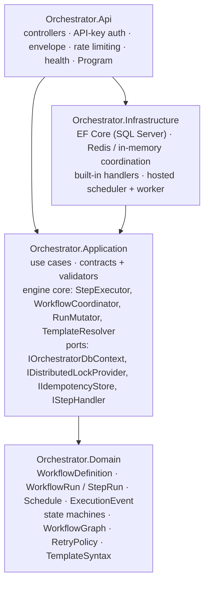
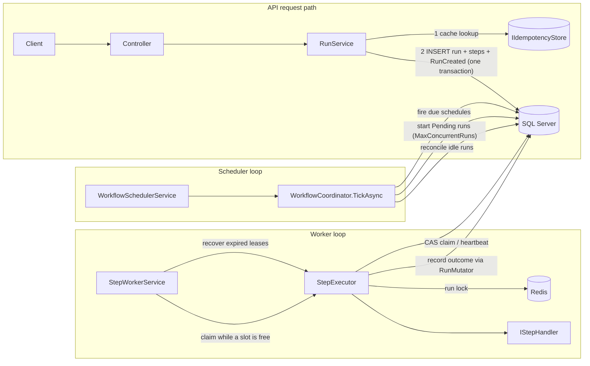

# Architecture

## Layers



| Layer | Responsibility | Notable choices |
| --- | --- | --- |
| Domain | Invariants and state transitions | No dependencies. `WorkflowRun` is the aggregate root for its `StepRun`s; every legal transition is in an explicit table and illegal ones throw `InvalidStateTransitionException`. |
| Application | Orchestration logic | Depends on EF Core abstractions on purpose: the claim protocol is a relational compare-and-swap (`ExecuteUpdateAsync`), and hiding it behind a repository would hide the most important query in the system. |
| Infrastructure | Adapters | SQL Server via EF Core, StackExchange.Redis, typed `HttpClient`, `BackgroundService`s. |
| Api | Transport | Controllers + Swagger, consistent envelope, `IExceptionHandler`, correlation-id middleware. |

## Components and data flow



### Request path

`POST /api/workflows/{id}/runs` validates the input, computes a canonical SHA-256 request hash, checks the
idempotency cache, then inserts the run, its step rows and the `RunCreated` event in one transaction. The response is
`202 Accepted` with a `Location` header; nothing is executed on the request thread.

### Scheduler (`WorkflowSchedulerService` → `WorkflowCoordinator.TickAsync`)

Every `Scheduler:PollInterval` (a `PeriodicTimer`):

1. **Fire schedules** whose `NextRunAt` is due. The new run gets the idempotency key `schedule:{id}:{slot}`, so two
   scheduler instances firing the same slot collide on the unique index instead of creating duplicates.
2. **Start due runs**: `Pending` runs with `ScheduledFor <= now`, oldest first, if the definition has fewer than
   `MaxConcurrentRuns` active (Running/Compensating) runs. `Start` promotes root steps to `Ready`.
3. **Reconcile idle runs**: Running/Compensating runs with no step a worker could act on (no Ready/Running/Retrying/
   Compensating step). `Reconcile` promotes steps whose dependencies succeeded, completes the run, or schedules the
   next compensation. Normally the worker already did this; this pass repairs runs left behind by a crash.

### Worker (`StepWorkerService` → `StepExecutor`)

Every `Worker:PollInterval`: recover expired leases, then claim and start steps while a `SemaphoreSlim` slot is free
(`Worker:MaxDegreeOfParallelism`). Each claimed step runs on the thread pool in **its own DI scope** (own `DbContext`):

1. **Claim** — read a batch of due candidates (Ready, Retrying with `NextAttemptAt <= now`, or Compensating) joined to
   an active run; for each, take the per-run Redis lock (skip if busy) and run the CAS `UPDATE`. One affected row = won.
2. **Execute** — resolve `{{...}}` templates, resolve the handler by type name, run it under a linked token
   (timeout ∧ host shutdown ∧ abort-from-heartbeat). A heartbeat loop extends the lease every `Worker:HeartbeatInterval`,
   rotates the fencing token, and aborts the attempt if the lease was lost or the run stopped running.
3. **Record** — `RunMutator` loads the run aggregate, checks that the step is still leased by this worker with the
   current fencing token, applies the outcome (`RecordStepSucceeded`, `RecordStepFailed` with the retry decision,
   `RecordCompensation*`, `ReleaseStep` on shutdown, `RecordStepCancelled`), lets `Reconcile` promote dependents /
   finish / compensate, and saves with optimistic concurrency (reload + reapply on conflict, up to 5 times).

## Concurrency model

| Mechanism | Protects | Notes |
| --- | --- | --- |
| CAS claim (`UPDATE ... WHERE Id AND Version AND Status AND LeaseOwner IS NULL`) | Two workers executing the same attempt | Correctness guarantee. Portable (SQL Server + SQLite). |
| `StepRun.Version` as fencing token | A worker that lost its lease recording a stale result | Heartbeats rotate it; recording requires the latest value. |
| `WorkflowRun.Version` concurrency token | Lost updates when two steps of a run finish at the same moment | Every aggregate mutation regenerates it, so concurrent bookkeeping on one run is serialised. |
| Redis per-run lock (`SET NX PX`, Lua compare-and-delete) | Wasted work and concurrency retries | Defence in depth only; held for bookkeeping, never while a handler runs. Outage ⇒ no-op. |
| Unique `(DefinitionId, IdempotencyKey)` | Duplicate runs | Source of truth for idempotency; Redis is a cache. |

## Splitting the worker into its own host

The API process runs both loops today for operational simplicity. Nothing in them depends on ASP.NET Core:

```csharp
// Orchestrator.Worker/Program.cs (future)
var builder = Host.CreateApplicationBuilder(args);
builder.Services.AddOrchestratorApplication();
builder.Services.AddOrchestratorInfrastructure(builder.Configuration);
builder.Services.AddOrchestratorWorkers();
builder.Build().Run();
```

Then set `Worker:Enabled=false` (and optionally `Scheduler:Enabled=false`) on the API deployment. Any number of worker
and scheduler instances can run concurrently: they coordinate only through the database (CAS claims, concurrency
tokens, unique indexes) and, optionally, Redis. Use `Redis:Enabled=true` whenever more than one instance runs — the
in-memory lock and idempotency cache are per-process.

## Configuration reference

| Key | Default | Purpose |
| --- | --- | --- |
| `ConnectionStrings:Orchestrator` | – | SQL Server connection string |
| `Database:ApplyMigrationsOnStartup` | `false` (`true` in Development/compose) | Run EF migrations at startup (never in `Testing`) |
| `Redis:Enabled` / `Redis:ConnectionString` | `false` / `localhost:6379` | Redis lock + idempotency cache vs in-memory |
| `Scheduler:Enabled` / `PollInterval` / `BatchSize` | `true` / `00:00:01` / `50` | Coordinator loop |
| `Worker:Enabled` / `PollInterval` / `MaxDegreeOfParallelism` | `true` / `00:00:01` / `4` | Worker loop |
| `Worker:LeaseDuration` / `HeartbeatInterval` | `00:00:30` / `00:00:10` | Lease length and renewal (heartbeat must be shorter) |
| `Worker:RunLockExpiry` / `RunLockWaitTimeout` | `00:00:15` / `00:00:05` | Redis lock TTL and how long recording waits for it |
| `Engine:MaxStepsPerWorkflow` / `IdempotencyCacheTtl` | `50` / `1.00:00:00` | Definition limit; cache TTL |
| `Handlers:Http:AllowedHosts` | `[]` (any) | SSRF allowlist for the `http` handler |
| `RateLimiting:RunCreation:PermitLimit` / `WindowSeconds` | `60` / `60` | Per-key run creation limit |
| `ApiKeys:Keys[n]:Name` / `KeyHash` / `Roles` | – | API clients (SHA-256 digests) |

All options are validated at startup (`ValidateOnStart`).
